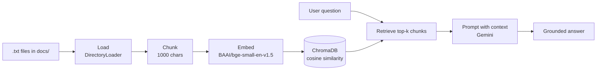

# Basic RAG: Document Q&A with LangChain, ChromaDB and Gemini

A command-line Retrieval-Augmented Generation (RAG) application. It ingests plain-text documents, stores them as embeddings in a local vector database, and answers questions **using only the content of those documents**. A second script adds multi-turn chat with conversation memory.

The sample corpus in `docs/` is two long text files (`Google.txt`, `Microsoft.txt`), but any `.txt` files placed in `docs/` will work.

It comes in two forms: **command-line scripts** and a **web app** (React + Vite frontend, FastAPI backend) where you enter your Gemini API key, upload or paste `.txt` documents, and ask questions in the browser. See [Web app](#web-app).

## How it works



**Ingestion** (`ingestion_pipeline.py`)

1. Loads every `.txt` file in `docs/`.
2. Splits the documents into 1000-character chunks with 100 characters of overlap, following paragraph and line boundaries, and drops chunks that are mostly citation lists (common in Wikipedia-style exports).
3. Embeds each chunk locally with `BAAI/bge-small-en-v1.5` (normalized embeddings, cosine similarity).
4. Persists the vectors to `db/chroma_db`. If that folder already exists, ingestion is skipped and the existing store is loaded.

**Single-question retrieval** (`retrival_pipeline.py`)

- Retrieves up to 5 chunks with a cosine-similarity threshold of 0.7, so irrelevant chunks are filtered out.
- Prompts Gemini to answer only from the retrieved context, and to reply "I don't have enough information in the documents." when the answer isn't there.

**History-aware chat** (`history_aware_rag.py`)

- Keeps the conversation as a list of messages.
- Before retrieval, rewrites follow-up questions (such as "what about its CEO?") into standalone, searchable questions using the chat history.
- Retrieves the top 3 chunks and answers from them, with the history included in the prompt.

## Tech stack

| Layer         | Choice                                                          |
| ------------- | --------------------------------------------------------------- |
| Language      | Python                                                          |
| Orchestration | LangChain                                                       |
| Embeddings    | `BAAI/bge-small-en-v1.5` via Hugging Face (runs locally)        |
| Vector store  | ChromaDB (persistent, cosine distance)                          |
| LLM           | Google Gemini (`gemini-3.6-flash`) via `langchain-google-genai` |

## Project structure

```
basic-rag/
├── docs/                    # Source documents (.txt)
│   ├── Google.txt
│   └── Microsoft.txt
├── ingestion_pipeline.py    # Load → chunk → embed → store
├── retrival_pipeline.py     # One-shot retrieval + answer generation
├── history_aware_rag.py     # Interactive chat with conversation memory
├── backend/
│   └── main.py              # FastAPI API: upload documents, ask questions
├── frontend/                # React + Vite web UI
│   ├── src/
│   │   ├── App.jsx
│   │   ├── api.js
│   │   ├── styles.css
│   │   └── components/      # DocumentsStep, Chat, ApiKeyField, ModelChips
│   ├── index.html
│   ├── package.json
│   └── vite.config.js
├── requirements.txt
└── .gitignore               # venv, .env, db/, node_modules are not committed
```

## Getting started

### Prerequisites

- Python 3.10+
- A Google AI (Gemini) API key

### Setup

```bash
git clone https://github.com/kagaha/basic-rag.git
cd basic-rag

python -m venv venv
source venv/bin/activate        # Windows: venv\Scripts\activate

pip install -r requirements.txt
```

Create a `.env` file in the project root:

```
GOOGLE_API_KEY=your_api_key_here
```

### Run

```bash
# 1. Build the vector store (first run downloads the embedding model)
python ingestion_pipeline.py

# 2a. Ask a single question (edit the `query` variable in the file)
python retrival_pipeline.py

# 2b. Or chat interactively with memory (type 'quit' to exit)
python history_aware_rag.py
```

To use your own documents, add `.txt` files to `docs/`, delete the `db/` folder, and run `ingestion_pipeline.py` again.

## Web app

The web app wraps the same pipeline: BGE embeddings, ChromaDB with cosine similarity, Gemini, and history-aware question rewriting.

**Flow:** enter your Gemini API key (masked) → upload `.txt` files or paste document text → see "Documents uploaded successfully" → ask questions → read the answer together with the source passages it was based on. The embedding model and LLM in use are shown in the header and above the chat.

### Run it

You need two terminals, both started from the repository root.

```bash
# Terminal 1: backend (http://localhost:8000)
source venv/bin/activate
uvicorn backend.main:app --reload --port 8000
```

```bash
# Terminal 2: frontend (http://localhost:5173)
cd frontend
npm install
npm run dev
```

Open http://localhost:5173. In development, Vite proxies `/api` requests to the backend.

### API

| Method   | Endpoint            | Purpose                                                                     |
| -------- | ------------------- | --------------------------------------------------------------------------- |
| `GET`    | `/api/config`       | Embedding model, LLM, chunking and retrieval settings                       |
| `POST`   | `/api/documents`    | Multipart upload of `.txt` files and/or pasted text; returns a `session_id` |
| `POST`   | `/api/ask`          | `{ session_id, question }` → answer, source passages with similarity scores |
| `DELETE` | `/api/session/{id}` | Discard a session's documents                                               |

### How the web app handles data

- The web app reuses `ingestion_pipeline.py` (line-ending normalization, chunking, embedding, storing), so the command-line scripts and the web app share one ingestion path. It retrieves the top 6 chunks per question.
- Follow-up questions are history-aware: the question is first rewritten as a standalone query using the conversation so far, then retrieval runs on the rewritten query, and the recent history is included when the answer is generated. This logic lives in `/api/ask` in `backend/main.py` (the command-line equivalent is `history_aware_rag.py`, which the web app does not import).
- Embeddings are computed locally by the BGE model; the API key is only used for the Gemini calls.

### API key handling

1. The key is typed into a masked field and held in React state only. It is not written to localStorage, cookies or the URL, and is not part of the frontend bundle.
2. The frontend sends it in an `X-Api-Key` header with each request (`frontend/src/api.js`).
3. The backend reads that header, builds the Gemini client for that single request, and discards it. It is never stored in a session, written to a file, logged or returned. Error messages have it redacted.
4. Refreshing the page clears it from memory, so it has to be entered again.

### Sessions and isolation

- Each upload creates a new random `session_id` (a 128-bit `uuid4`) and its own in-memory ChromaDB collection, so documents and chat history are separate for every user. If user A uploads Google documents and user B uploads Facebook documents, a question from A is only ever searched against A's collection and never returns B's content.
- Nothing is written to disk. Sessions are lost when the server restarts.
- There are no user accounts: the `session_id` is the only handle to a session. It is unguessable and kept only in the user's browser state, but it is not real authentication.

### Known limits for a public deployment

- **20 sessions at most** (`MAX_SESSIONS` in `backend/main.py`). When a 21st upload arrives, the oldest session is deleted and that user sees "This session has expired". Raise the limit or add an idle timeout for real traffic.
- **In-memory sessions need a single server process.** With multiple workers (`--workers 2`), each worker has its own memory, so a request can reach a worker that does not have the session.
- **Memory grows with users**, because every session's embeddings stay in RAM until it is evicted or the user clicks "Use different documents".

### Deployment checklist

- [ ] Serve both frontend and backend over **HTTPS**
- [ ] Set `CORS_ORIGINS` to your real frontend URL only
- [ ] Set `VITE_API_BASE` to the backend URL when building the frontend
- [ ] Add a Content-Security-Policy header on the frontend host
- [ ] Commit `package-lock.json` and keep dependencies updated
- [ ] Run a single backend worker, or move sessions to a shared store
- [ ] Add rate limiting and an idle session timeout
- [ ] Prefer test keys with low quota that you can rotate in Google AI Studio

## Configuration

| Setting               | Where                                              | Default                                     |
| --------------------- | -------------------------------------------------- | ------------------------------------------- |
| Chunk size / overlap  | `split_documents()` in `ingestion_pipeline.py`     | 1000 / 100                                  |
| Embedding model       | `get_embedding_model()` in `ingestion_pipeline.py` | `BAAI/bge-small-en-v1.5`                    |
| Vector store location | `persistent_directory`                             | `db/chroma_db`                              |
| Retrieved chunks (k)  | retriever in each pipeline                         | 5 (single query), 3 (CLI chat), 6 (web app) |
| Relevance threshold   | `retrival_pipeline.py`                             | 0.7 cosine similarity                       |
| LLM                   | `ChatGoogleGenerativeAI(model=...)`                | `gemini-3.6-flash`                          |

## Current limitations

This is a learning project and a deliberately simple baseline:

- `.txt` documents only (no PDF or DOCX support).
- The web app keeps sessions in memory only: no user accounts, no persistence, no streaming of answers.
- Answers are shown as plain text (no Markdown rendering).
- `retrival_pipeline.py` uses a hardcoded question, and `history_aware_rag.py` retrieves top-k without the relevance threshold (the threshold code is commented out).
- Answers do not show their source chunks or citations.
- No automated tests or retrieval-quality evaluation.

## Roadmap

- [x] Wrap the pipeline in a REST API (FastAPI) and add a React chat UI
- [x] File upload (.txt) and pasted text
- [x] Show source passages alongside answers
- [ ] PDF support
- [ ] Semantic chunking
- [ ] Stream answers and render Markdown
- [ ] Apply the relevance threshold in chat mode
- [ ] Retrieval evaluation set and basic tests
- [ ] Dockerize and deploy a live demo

## Related

[`llm-basics`](https://github.com/kagaha/llm-basics): the LLM fundamentals (API calls, tool calling, structured output) that this project builds on.
